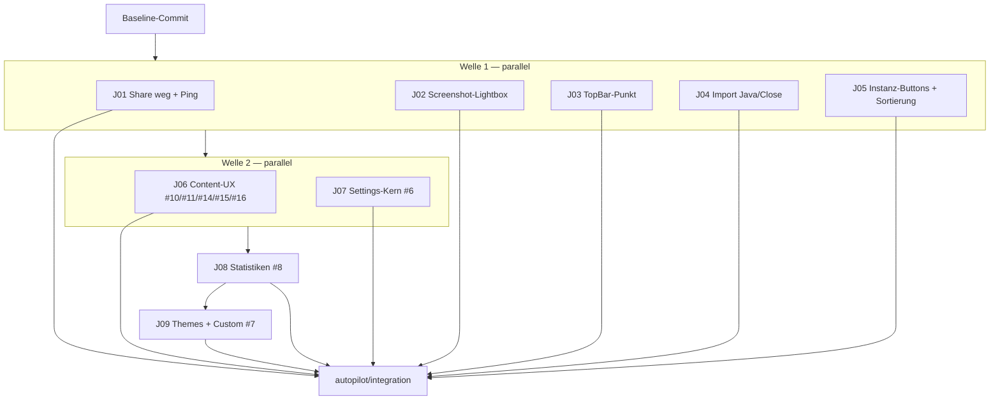

# mc_plan v0.2.2 — Autopilot

Automatisierter Umsetzungsplan für `BambooLauncher v0.2.2.md` (16 Punkte).

## 0. Autopilot-Vertrag

- Keine Rückfragen pro Schritt. Entscheidungen werden getroffen, dokumentiert und im Zweifel
  konservativ (kleinster sicherer Eingriff) umgesetzt.
- Jeder Job läuft in einem **eigenen Git-Worktree** auf eigenem Branch, ausgehend von
  `autopilot/integration`.
- Ein Job gilt nur als erfolgreich, wenn `npm run build` **und** `npm run lint` grün sind
  (plus job-spezifische Tests). Erst dann wird gemerged.
- Nach jedem Merge läuft das Integrations-Gate erneut. Rote Gates blockieren den nächsten Merge.
- Harte Blocker (fehlende Assets, widersprüchliche Anforderung, nicht reproduzierbarer Bug)
  werden im Status-Log als `BLOCKED` markiert, ohne den Rest der Kette anzuhalten.
- Der Arbeitsbaum des Nutzers wird nie verworfen: der komplette Ist-Stand wird vorher als
  `autopilot/baseline` committet. `main` bleibt unangetastet.

## 1. Ausgangslage (verifiziert)

| Fakt | Wert |
|---|---|
| Repo | `BambooLauncher/` (Git, Branch `main` @ `7eb129e`) |
| Arbeitsbaum | **stark schmutzig**: 102 Einträge, fast alle relevanten Dateien *untracked* |
| Konsequenz | Worktrees von `HEAD` würden eine **alte Codebasis** enthalten → Baseline-Commit nötig |
| Große untracked Assets | `resources/Instanz Vorlagen/` ≈ 500 MB, `mod/` ≈ 73 MB → aus Baseline ausgeschlossen |
| Build | Vite 8 + React 19 + TS 6 + Electron 30; `npm run build`, `npm run lint`, `npm run test:core` |
| CI | `.github/workflows/core-ci.yml`: lint → offline core suite → build |

## 2. Abhängigkeitsanalyse

### 2.1 Datei-Kollisionen (das eigentliche Kriterium für Parallelität)

| Datei | Jobs | Regel |
|---|---|---|
| `src/components/SettingsView.tsx` (1626 Z.) | J07, J08, J09 | **strikt seriell** (J07 → J08 → J09) |
| `src/components/InstancesView.tsx` (3081 Z.) | J05, J06 | **seriell** (J05 → J06) |
| `src/components/ModsView.tsx` | J06 | nur J06 |
| `main.js` / `preload.js` | J01, J08 | J01 in Welle 1, J08 in Welle 3 (keine Überschneidung) |
| `src/components/MultiplayerView.tsx` | J01 | nur J01 |
| `src/lib/translations.ts` | J04, J05, J06, J07 | additiv; Konflikte beim Merge auflösen |
| `src/components/ProfileImportModal.tsx` | J04 | nur J04 |
| `src/components/TopBar.tsx` | J03 | nur J03 |
| `src/components/ScreenshotsView.tsx` | J02 | nur J02 |

### 2.2 Inhaltliche Abhängigkeiten

- **#1 + #2** teilen sich `MultiplayerView.tsx` und `main.js` (Share-UI + Ping-Handler) → ein Job.
- **#12 + #13** teilen sich den Import-Flow (`ProfileImportModal` + `profileImport`) → ein Job.
- **#14 + #15** sind zwei Seiten derselben Aktion (`enableOwnContentManagement`) → mit #10/#11/#16
  in J06, weil alle `InstancesView`/`ModsView` anfassen.
- **#6 → #8 → #9(Themes)**: Statistik-UI und Theme-UI leben beide in `SettingsView`; die
  Settings-Struktur (#6) muss zuerst stehen, sonst werden Navigation und Tab-IDs doppelt umgebaut.
- **#4/#5 → #10/#11/#14/#15/#16**: erst Toolbar/Sortierung (klein, isoliert), dann die große
  Content-UX-Welle auf demselben File.
- **#3, #9** sind vollständig isoliert und können sofort parallel laufen.

## 3. Jobs

Maschinenlesbar: `scripts/mc-plan/plan.v022.json`.

### J01 — `net-share-ping` (#1, #2)

**Ziel**
- Mehrspieler-Share/Invite-System komplett entfernen (UI, Deep-Link-Protokoll, Join-Service,
  Preload-API, IPC, Tests). Serverliste/LAN bleibt.
- Server-Ping: kostenlose API, parallel + harter Timeout, **kein** Auto-Refresh, **keine**
  Ping-ms-Anzeige. Manuelles Aktualisieren bleibt.

**Dateien**: `MultiplayerView.tsx`, `main.js`, `preload.js`, `src/electron.d.ts`, `App.tsx`,
`electron/join/*`, `join/JoinSheet.tsx`, `hooks/useJoinInvites.ts`, `tests/join*.cjs`,
`tests/preload-contract.test.cjs`, `tests/ipc-owner.test.cjs`.

**Akzeptanz**
- Kein `Share2`-Button, kein Invite-Dialog, kein `bamboo-launcher://invite`-Handler mehr.
- `ping-server` nutzt `AbortController` (≤ 4 s), normalisiert `{online, players, maxPlayers, motd}`,
  kein `ping`-Feld im Renderer.
- Kein `setInterval`-Auto-Refresh; nur manueller Refresh.
- `npm run build`, `npm run lint`, `npm run test:core` grün.

### J02 — `screenshots-lightbox` (#3)

**Ziel**: Lightbox-Header wird oben abgeschnitten (Overlay liegt im Scroll-Container unter
`overflow-hidden`/Transform-Ancestoren). Lightbox per `createPortal` an `document.body` rendern,
`fixed inset-0`, Header mit Safe-Area, Body-Scroll-Lock, Z-Index über TopBar.

**Dateien**: `ScreenshotsView.tsx`, ggf. `index.css`.

**Akzeptanz**: Header (Datum, Auflösung, Größe, Buttons) ist bei jeder Fenstergröße vollständig
sichtbar; Esc/Pfeile/Backdrop unverändert; keine Regression im Grid.

### J03 — `topbar-account` (#9)

**Ziel**: Den Punkt am Skin/Avatar im Konto-Popover entfernen (Status-Dot, `TopBar.tsx:102`).

**Dateien**: `TopBar.tsx`.

**Akzeptanz**: Kein Dot mehr am Avatar; Trigger, Popover und „Konten verwalten“ unverändert.

### J04 — `import-flow` (#12, #13)

**Ziel**
- Java ist beim Import **kein Konflikt** mehr (auch nicht als Info). Java-Prüfung nur beim Start.
- Import-Modal ist während des Imports schließbar (X, Backdrop, Esc). Import läuft als
  Background-Task weiter und ist in der Task-Leiste sichtbar.

**Dateien**: `services/profileImport.ts`, `ProfileImportModal.tsx`, ggf. `translations.ts`.

**Akzeptanz**: `missing_java` wird nicht mehr erzeugt; `requestClose` wird von allen drei
Schließwegen genutzt; keine State-Updates nach Unmount; Task bleibt nach Schließen aktiv.

### J05 — `instances-toolbar-sort` (#4, #5)

**Ziel**
- Instanz-Großansicht: 4 Buttons neu anordnen. „Alle aktualisieren“ prominent **mit Beschreibung,
  welche Mods Updates haben**; „Hochladen“ nur Icon + Tooltip, passend platziert; „Neu laden“
  unauffällig (Ghost/Icon); „Inhalte hinzufügen“ bleibt primär.
- Mods/Inhalte/Welten/Instanzen **immer nach Name** sortieren (localeCompare, numerisch),
  keine Sortierung nach Installationsgröße.

**Dateien**: `InstancesView.tsx`, `translations.ts`.

**Akzeptanz**: Update-Button zeigt z. B. „3 Updates · Sodium, Iris, …“; Icon-only-Upload hat
`aria-label`/Tooltip; alle Listen A→Z; `npm run build` + `lint` grün.

### J06 — `instances-content-ux` (#10, #11, #14, #15, #16)

**Ziel**
- **#10**: Mod-Browser-Seite + Scrollposition bleiben erhalten, wenn eine Instanz geöffnet und
  wieder geschlossen wird (sessionStorage-Cache + `useLayoutEffect`-Restore).
- **#11**: Versionsliste im Mod-Detail zeigt pro Version Install-Status/Prozent; „Installiert“
  markiert die aktive Version; Wechsel **ersetzt** die bestehende Datei (kein Duplikat).
- **#14**: Nach Aktivieren eigener Mods verschwindet der Banner überall; vorher Warnung
  („Nicht empfohlen bei Modpacks – Updates/Konflikte; bei eigenen Instanzen/Transfers normal“).
- **#15**: Aktivieren eigener Mods entsperrt **alle** Inhalte.
- **#16**: Mod-Detail-Menü schöner + vollständige Infos + „Im Browser öffnen“ für alle Quellen,
  direkt neben den Aktionen; Versionswechsel direkt im Dialog.

**Dateien**: `InstancesView.tsx`, `ModsView.tsx`, `InstanceSettingsView.tsx`, `translations.ts`,
ggf. `lib/modVersions.ts`.

**Akzeptanz**: Scroll/Pagination-Restore reproduzierbar; pro-Version-Progress sichtbar; keine
Doppelinstallation; Warnung erscheint genau einmal vor Aktivierung; Unlock gilt für alle Items.

### J07 — `settings-core` (#6)

**Ziel** (alle Unterpunkte)
- „Über“: Logo statt `Layers`-Icon; „Keine Updates gefunden“ statt „fehlgeschlagen“ (auch Startseite).
- „Über“: Community-Absatz ersetzen durch „Made by Borisgamer“ + „© 2026 Bamboo Launcher“.
- „Erweitert“: Sicherheit-Karte und Gesamtlayout übersichtlicher.
- Sidebar: Gruppen-Untertitel „Launcher“, „In-Game“, „System“.
- „Spiel“: „Instanz-Standards“ entfernen; Texte kürzen (überall in den Einstellungen).
- „Im Vollbild starten“ zu den Spieloptionen verschieben.
- „Steuerung“ → „Key-Binds“ (EN) / „Tastenbelegungen“ (DE); Spieloptionen (z. B.
  Mausempfindlichkeit) werden tatsächlich übernommen.
- Game-Untertabs als eigene Sidebar-Tabs: „Java & Speicher“, „Spieloptionen“, „Key-Binds“.
- „Sprache“: Text deutlich reduzieren.

**Dateien**: `SettingsView.tsx`, `settings/GameOptionsPanel.tsx`, `settings/KeybindsPanel.tsx`,
`lib/launcherPreferences.ts`, `lib/gameOptions.ts`, `lib/keybinds.ts`, `lib/settingsNavigation.ts`,
`main.js` (Options-Patch, falls nötig), `translations.ts`, `Dashboard.tsx`.

**Akzeptanz**: Navigation über `requestSettingsTarget` funktioniert für alle neuen IDs;
`options.txt` enthält die gesetzten Werte inkl. `mouseSensitivity`; Build/Lint grün.

### J08 — `statistics` (#8)

**Ziel**: Globale Statistiken (Playtime gesamt, Blöcke abgebaut/platziert, gelaufen, Sessions)
aus allen Instanzen aggregieren; **bleiben nach Instanz-Löschung erhalten**; eigener
Settings-Bereich unter der System-Gruppe; Toggle (Standard: an) zum Abschalten der Erfassung.

**Dateien**: neu `electron/stats.ts`, `electron/ipc.ts`, `main.js`, `preload.js`,
`src/electron.d.ts`, `SettingsView.tsx`, neu `settings/StatisticsPanel.tsx`,
`hooks/useLaunchController.ts`, `hooks/useInstances.ts`.

**Akzeptanz**: `stats.json` in `appData`; Löschen einer Instanz reduziert Totals nicht; Toggle
stoppt Erfassung sofort; Anzeige formatiert (DE/EN); Build/Lint grün.

### J09 — `themes-custom` (#7)

**Ziel**: 9 Presets + Custom-Modus mit Switch oben.
- Presets: Bamboo Forest, End City, Snowy Lands, Nether Fortress, Obsidian Portal, Warden Valley,
  Copper Trials, Underwater Paradise, Cherry Blossom — mit den gelieferten Farben (leicht
  augenschonend angepasst), BG-Bild, einheitlicher mittlerer Helligkeit/Blur, DE/EN-Beschreibung.
- Custom: Farbwähler, eigenes Hintergrundbild (Upload), Effekt-Slider.

**Dateien**: `data/themes.ts`, `services/themeService.ts`, `hooks/useTheme.ts`,
`hooks/useAppearance.ts`, `SettingsView.tsx`, `ParticleBackground.tsx`, `hooks/usePersistence.ts`,
`electron/schemas.ts`, `index.css`, `public/images/*`.

**Akzeptanz**: 9 Presets auswählbar; Custom bleibt nach Neustart erhalten; Preset-Wechsel
überschreibt Custom nicht; Bilder werden gebündelt aus `public/images` geladen.

> **BLOCKED Assets**: `minecraft-trial-chambers.webp`, `058e8b6d…_350.webp`, `fnz9c0cbmd6f1.png`
> existieren nicht in `Downloads`. Copper/Underwater/Cherry erhalten zunächst vorhandene
> Platzhalterbilder + `TODO(asset)`; Rest des Themes funktioniert vollständig.

## 4. Wellen & Merge-Reihenfolge

| Welle | Jobs (parallel) | Start nach |
|---|---|---|
| 1 | J01, J02, J03, J04, J05 | Baseline |
| 2 | J06, J07 | alle Welle-1-Merges grün |
| 3 | J08 | J07-Merge grün |
| 4 | J09 | J08-Merge grün |

Merge: `git merge --no-ff job/<id>` in `autopilot/integration`, danach Integrations-Gate.
Bei Konflikt: betroffene Hunks manuell zusammenführen, Gate erneut.

## 5. Risiken

| Risiko | Umgang |
|---|---|
| Schmutziger Arbeitsbaum | Baseline-Commit auf eigenem Branch; `main` unverändert |
| 500 MB Wallpaper-Zips | via `.git/info/exclude` aus Baseline/Worktrees ausgeschlossen (bleiben auf Platte) |
| Fehlende Theme-Bilder | Platzhalter + `TODO(asset)`, als BLOCKED geloggt |
| `SettingsView`-Konflikte | J07/J08/J09 strikt seriell |
| `translations.ts`-Konflikte | additive Keys, Merge-Konflikte manuell |
| Parallele Builds teilen `node_modules` | Junction je Worktree, eigener `dist`/`tsbuildinfo` |
| Java/Keybind-Bug nicht rein UI | J07 prüft `options.txt`-Ausgabe und Backend-Patch |

## 6. Status-Log

| Zeit | Job | Status | Gate | Merge |
|---|---|---|---|---|
| — | Baseline | pending | — | — |
